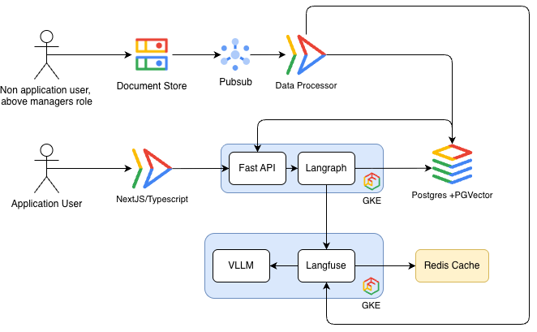

# Student advisory development instructions

## Read documents first
    - Read docs/PRD.md for Product Requirements Information
    - Read docs/ACCESS_CONTROL.md for access control information
    - Read docs/RAG_DESIGN.md for RAG design architecture
    - Read docs/GOOGLE_CLOUD_DEVELOPMENT.md for cloud implementation and deployement information
    - Read docs/IMPLEMENTATION_BACKLOG.md for backlog of the feature developments
    - Read docs/CODEX_GUIDE.md for codex guidlines
    - Local development information
      - frontend/AGENTS.md 
      - backend/AGENTS.md
    - Read docs/SOURCES.md for references (Optional)

## Work procedures
1. Read the selected item from backlog (Ignore all Status = Completed Tasks)
2. Chage the Status = Inprogress
3. Run relevant checks, Keep frontend and backend contracts consistent.
4. Record unresolved institutional choices as assumptions. 
5. Implement the frature
6. Once completed, Chage the Status = Completed
**Constraint** Do not invent course requirements, approvals, research evidence, benchmark results, or legal conclusions.

## Mandatory invariants
- Resolve authorization on the server for every object, query, export, event, download, and background task. Deny by default.
- Scope by institution and org unit, then relationship, current grant, resource state, and action. Student documents require the student membership ID.
- Filter retrieval before candidate selection. Never send unauthorized chunks to a model or reranker.
- Advisor guidance events do not trigger assistant replies. Use relevant student-visible guidance on later student turns. Staff-only notes never enter student-facing prompts.
- Official requirements constrain plans. Advisor guidance is prioritized for planning; it cannot create an unapproved policy waiver.
- Only published applicable sources support institutional claims. Validate citations and abstain or escalate when support is insufficient.
- A signature applies to one immutable form revision. Enforce student then advisor then manager in transactions. No proxy signatures.
- No real student records in development, tests, prompts, screenshots, or logs. Use synthetic fixtures.
- Keep credentials and cloud project identifiers out of committed source; use workload identities and Secret Manager in cloud.

## Engineering Desgin

## Checks and delivery
1. Provide requirements addressed, files changed, checks actually run, and remaining limitations. 
2. Add meaningful tests for authorization, retrieval boundaries, and form state changes. 
3. Run `scripts/validate_package.py` for package integrity
4. The project `.rules` file is a command guardrail, not an authorization system or a full command allowlist.

## Personas and skills
Read .codex/personas/README.md before selecting a specialist perspective. Persona Markdown does not register autonomous agents. Use the repo workflows under .agents/skills for focused tasks. Do not start parallel agents unless the user requests delegation. Keep docs and instructions synchronized with implementation.

## Code review rules
Block cross-scope data access, uncited institutional claims, staff-note leakage, implicit privilege escalation, signature mutation, secrets, model-triggered actions without backend authorization, and migrations that destroy active records without an approved data plan.
