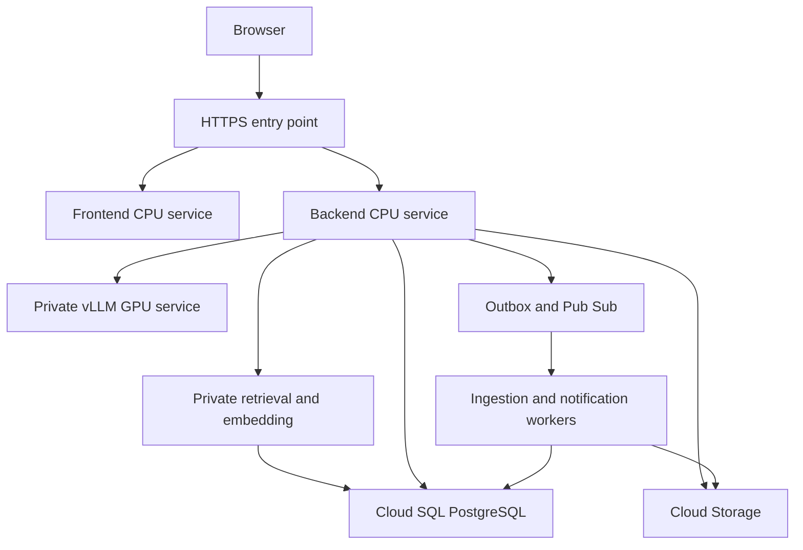

# Google Cloud and vLLM development guide

This guide defines a proposed deployment and a reproducible implementation sequence. It does not provision resources. Templates contain explicit REPLACE values and are not production-ready manifests. Never apply them until a model, GPU profile, networking design, identity provider, privacy policy, and budget have been selected and verified. Refer to SOURCES.md for official references checked on November 5, 2026; recheck version-dependent flags before deploying.

## 1 Runtime topology

Use separate GCP projects for development, staging, and production. Start with GKE Standard for CPU application workloads plus a dedicated GPU node pool for vLLM. Keep frontend and backend as separate containers behind a single HTTPS entry point. Route /api to the backend and other paths to the frontend. Establish same-origin secure cookies and CSRF protection. Use a Gateway/HTTPRoute or Ingress appropriate to the chosen GKE version, explicit health checks, managed TLS, and institution-controlled DNS.



The diagram describes intended service relationships, not provisioned network routes. vLLM has a ClusterIP service only and no external gateway route. The API is its normal caller. Explicit evaluation pods may receive a temporary approved network grant. The embedding/reranking services have their own identity and resource sizing. Do not assume the chat model can provide embeddings.

## 2 Prerequisites and decisions

Install a tested Google Cloud CLI, kubectl with the GKE auth plugin, Terraform, Docker, a Python environment manager, and Node on the development machine. Record actual versions in a tool-version file at bootstrap. Select a supported GKE release channel and Cloud SQL PostgreSQL version with compatible pgvector extension support. Pin providers and application dependencies with lockfiles. The package intentionally does not invent current version numbers.

Before allocating GPU resources, obtain regional GPU quota and check actual accelerator availability, machine-family compatibility, driver requirements, and zonal supply. Select an approved open-weight instruct model with a compatible chat template, immutable weights revision, license, model card, and sufficient advising evaluation. A 7–9B model and one L4-class GPU can be a benchmarking candidate, but fit depends on weights, precision, context, KV cache, and concurrency; there is no fit guarantee.

For each environment record project ID, region, zones, domain, institution ID, owner, billing account, budget, alert contacts, identity provider, retention policy, and allowed model license. Keep these in an operator-controlled environment inventory rather than committed credentials.

## 3 Project setup sequence

These commands list services to enable after selecting a project; enabling services may affect billing. Set ADVISORY_PROJECT_ID and ADVISORY_REGION explicitly. Commands are reference instructions and have not run in this package.

```bash
export ADVISORY_PROJECT_ID='replace-project-id'
export ADVISORY_REGION='replace-region'
gcloud services enable container.googleapis.com compute.googleapis.com sqladmin.googleapis.com storage.googleapis.com artifactregistry.googleapis.com secretmanager.googleapis.com pubsub.googleapis.com logging.googleapis.com monitoring.googleapis.com iam.googleapis.com iamcredentials.googleapis.com sts.googleapis.com --project "$ADVISORY_PROJECT_ID"
```

Enable additional APIs only when the selected implementation requires them. Use infrastructure as code for the following resources, with reviewed plans and remote state protected by versioning and restricted IAM:

1. VPC, subnet secondary ranges for GKE, private Google API access, controlled NAT/egress, and private database connectivity. Avoid unrestricted public database IPs.
2. GKE Standard with private nodes, Dataplane V2 or confirmed network-policy enforcement, Workload Identity Federation, controlled control-plane access, CPU pool, and tainted GPU pool. Confirm the GPU driver/device plugin for the selected GKE release.
3. Artifact Registry repositories with vulnerability scanning and retention rules.
4. Cloud SQL PostgreSQL with private connectivity, backups, point-in-time recovery where selected, maintenance settings, and restore policy. Use a migration identity separate from the API identity. Verify the supported vector extension version and install CREATE EXTENSION vector in a reviewed migration; do not assume every Postgres version supports the same features.
5. Private Cloud Storage buckets for quarantine, published sources, and form artifacts. Use uniform bucket-level access, public access prevention, appropriate lifecycle/retention rules, and distinct service permissions.
6. Pub/Sub topics/subscriptions with dead-letter routing and bounded retry; create a database outbox publisher. Pub/Sub delivery does not replace the database transaction that creates the event.
7. Secret Manager secrets and per-workload IAM grants. Avoid downloadable service-account keys.
8. Separate Kubernetes namespaces for app and model services, service accounts, network policies, TLS entry point, and monitoring.

Prefer Terraform variables and per-environment state. Provisioning, database migration, and workload rollout are separate CI stages. Before apply, verify project, state workspace, plan summary, resource cost implications, and intended environment against the operator inventory.

## 4 Identity and secrets

Use Workload Identity Federation for GKE to grant Google API permissions to exact Kubernetes service-account principals, directly or through an IAM service account where a service requires it. Do not grant project-wide Editor. Suggested boundaries:

| Workload | Required resource access | Excluded access |
| --- | --- | --- |
| API | App DB role, selected application secrets, source/artifact mediated access, outbox writes | Infrastructure admin, model download credentials |
| Ingestion | Quarantine read, extracted content write, embedding call, scoped ingestion DB role | Signature writes, role administration |
| Outbox publisher | Outbox rows and specific Pub/Sub topic publish | Arbitrary record export |
| Notification worker | Authorized notification read and approved mail-provider secret | Raw transcript export |
| vLLM | Read-only approved model cache and runtime auth secret | Student DB, source buckets, signing keys |
| CI builder | Artifact Registry write and build inputs | Production records |
| CI deployer | Narrow environment deployment identity | Database-owner access during normal rollout |

Load secrets through an approved Secret Manager integration. The Kubernetes vllm-runtime secret name in the template is an interface contract, not a committed secret manifest. The application holds the vLLM service token and sets the Authorization header; browsers never receive it. Rotate service tokens with a coordinated overlap/restart design. Model access tokens are separate from inference-service tokens. The template uses a preloaded model volume to avoid downloading arbitrary remote code at pod startup.

## 5 Local development

Use synthetic identity and academic fixtures for two departments, two advisors, a secretary, manager, and student accounts. Do not connect local workstations to production databases. Bring up a disposable PostgreSQL/pgvector instance, then scaffold and run API and frontend. Use a deterministic mock inference adapter for fast tests. The mock must identify itself in development and must not be an allowed production provider.

After application scaffolding creates real commands and lockfiles, the expected workflow is:

```bash
# From backend after pyproject.toml and uv.lock exist
uv sync --frozen
uv run alembic upgrade head
uv run pytest
# From frontend after package.json and package-lock.json exist
npm ci
npm run typecheck
npm run test
```

Release 0.1 now includes the foundation app and these commands; follow ../README.md for the current local setup. Live inference and cloud deployment remain unimplemented. Use .env.example as a variable contract; keep .env untracked. Never enable mock auth or inference based only on an arbitrary request header. Production startup must reject AUTH_MODE=mock, INFERENCE_PROVIDER=mock, missing secrets, insecure cookies, and an external unrestricted vLLM URL.

For a real local GPU inference test, use a Linux NVIDIA host with a compatible driver and NVIDIA Container Toolkit. A laptop without a supported GPU should use the mock adapter or a private development inference endpoint. With approved weights preloaded into a local directory and the image pinned:

```bash
docker run --rm --gpus all \
  -p 127.0.0.1:8001:8000 \
  --shm-size=4g \
  --env VLLM_API_KEY \
  --mount type=bind,src="$ADVISORY_MODEL_PATH",dst=/models/advisory,readonly \
  "$ADVISORY_VLLM_IMAGE" \
  --model /models/advisory \
  --served-model-name advisory-chat \
  --host 0.0.0.0 --port 8000 \
  --max-model-len 8192 \
  --gpu-memory-utilization 0.85 \
  --max-num-seqs 8 \
  --disable-log-requests
```

Set ADVISORY_MODEL_PATH to an absolute existing model directory, ADVISORY_VLLM_IMAGE to a tested digest-pinned vllm/vllm-openai image, and VLLM_API_KEY through the local secret mechanism. Never paste real tokens into committed commands. The model/context/concurrency settings above are starting hypotheses and must fit the selected GPU. Check flags and API-key environment behavior against the pinned image. Do not enable --trust-remote-code without a separate code review.

## 6 Inference deployment

infra/k8s/vllm.template.yaml provides a one-replica starting template with a read-only model PVC, GPU request, startup/readiness/liveness probes, ClusterIP service, service account, explicit API-key interface, ephemeral shared memory, and a capped token/concurrency configuration. Pin image digest and weights revision. Replace the GPU node selector, resources, UID/GID compatibility, model PVC, and namespace values with tested environment choices.

Load approved model files through a controlled prefetch job using a restricted identity and immutable model revision. Mount the serving cache read-only after verifying weights and tokenizer. A ReadWriteOnce volume generally cannot support replicas across arbitrary nodes; use per-replica caches or a compatible storage design when scaling. Do not add replicas to this template without resolving storage, node/GPU capacity, and warmup behavior.

infra/k8s/vllm-network-policy.template.yaml allows model traffic only from labeled API pods in the labeled application namespace. Label-setting is privileged cluster authority; do not let untrusted users create caller pods. NetworkPolicy does not authenticate a user or encrypt traffic. Add service-to-service TLS/mTLS through an approved mesh or terminating proxy before production. The NetworkPolicy template constrains model ingress only. Platform-wide default-deny egress and exact allowances for DNS, identity metadata, monitoring, database, Pub/Sub, and Google APIs must be implemented and tested as infrastructure work.

A /health check validates process/model readiness as supported by the pinned image; it is not an end-to-end advising test. Probe behavior, including whether auth is required, must be verified on the chosen image. Never embed a bearer token in a probe command or manifest. Set a startup window long enough for approved model load time and conservative liveness checks that do not kill healthy pods under load.

The backend uses /v1/chat/completions with the fixed served alias advisory-chat. Set temperature and output limits server-side, use bounded timeouts and queue admission, and validate model JSON in the application. Structured output capabilities vary by model and vLLM release; validate them on the pinned combination. No student prompt may select model paths, tool functions, or remote URLs. Separate endpoints serve embeddings/reranking with pinned models. Tokenize using the exact chat model tokenizer for budget accounting.

## 7 CI and deployment gates

For each PR: lint/typecheck application code; run authorization, RAG-filter, advisor-event, form-state, and contract tests; run migration checks against disposable Postgres; scan dependencies and containers; check templates; evaluate changes to model/prompt/retrieval on the frozen set. Build immutable images once and promote the same digests. Do not include student data in build context or CI logs.

Authenticate CI to GCP using workload federation and short-lived credentials. Provision reviewed infrastructure separately. Run backward-compatible expand migrations first, deploy compatible API/worker versions, then frontend, and only later contract migrations. A failed rollout must not require destructive DB reversal. Keep old readers compatible with queued event schemas.

Stage first, warm model weights, check /health and /v1/models from an authorized caller, run a chat smoke test with synthetic evidence and an unauthorized-call test, verify SQL source isolation, and complete the three-signature workflow. Load-test the recorded target profile including long contexts, model downtime, and queue saturation. Publish metrics and actual limitations before promotion.

## 8 Monitoring and cost

Monitor API errors/latency, authorization denials, vLLM readiness, GPU memory/utilization, tokens per second, queue depth, timeouts, failed extraction, stale indexes, case backlog, outbox lag, dead letters, and signature conflicts. Alerts should link to restricted operational dashboards without embedding student content.

Estimate monthly cost from GPU hourly price × allocated hours × replicas, CPU nodes, GKE fees, Cloud SQL, persistent storage/model cache, load balancer, egress, telemetry, and notification provider. Get actual prices and quota in the selected region; this package has no cost estimate. Budget alerts notify and do not enforce a hard cap. Apply quotas and concurrency limits. A model Deployment at zero replicas may still leave a billable GPU node allocated. Development shutdown must scale the workload and the dedicated node pool according to the approved cluster policy; verify allocation and residual storage/IP costs. Production shutdown is an explicit operational action.

Do not expose request bodies in inference logs. Disable request logging and verify monitoring agents are not ingesting prompts. Retain only structured trace IDs, source/version references, latency, tokens, and error classes unless an institution-approved restricted diagnostic process permits more.

## 9 Backup restore and rollback

Back up Cloud SQL and version important objects according to approved retention. Keep form canonical snapshots and artifacts in a recoverable consistent relationship. Rebuild vector indexes from durable source versions and recorded embedding configurations. Rehearse restoring into an isolated environment, rerunning permission tests, reconciling deletions/legal holds, and resuming outbox consumers without duplicate email or signatures.

Rollback application deployments to known image digests. Rollback knowledge/prompt releases by switching approved release pointers; do not relabel withdrawn private sources as published. Restore the prior compatible embedding index when switching embedding versions. GPU/model rollback needs the previous weights cache and capacity; retain both until the new release is accepted. A rollback never edits completed forms.

## 10 Production readiness decisions

The pilot owner must resolve identity integration, email delivery provider and terms, student-record access policy, accepted form signature method, retention/legal holds, data region, GPU/model license, capacity and availability targets, private TLS, incident ownership, backup restoration, and billing controls. These are deployment inputs; no infrastructure was created by preparing this package.
